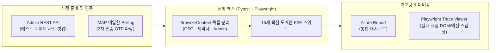

# Parmple E2E Test Automation Framework
> **B2B 제약 CSO ERP 서비스를 위한 Playwright 기반 E2E 테스트 자동화 프레임워크**

[](https://www.python.org/)
[](https://playwright.dev/)
[](https://docs.pytest.org/)
[](https://appium.io/)
[](https://allurereport.org/)

---

## 🎬 시연 영상 및 결과 산출물
- 🎬 **[Web] Playwright + Pytest 16개 핵심 도메인 회귀 테스트 시연 (메인)**: [▶️ YouTube 바로보기](https://youtu.be/t7XDqr4cbYw)
- 🎬 **[App] Android 하이브리드 앱 Appium 스모크 테스트 시연 (메인)**: [▶️ YouTube 바로보기](https://youtu.be/AGG6c-pH-6g)
- 🎬 **[R&D PoC] AI 활용 점진적 TC 도출 및 화면 분석 시연 (연구용 PoC)**: [▶️ YouTube 바로보기](https://youtu.be/mywifH10t74)
- 📁 **Allure 테스트 결과 리포트 및 산출물 샘플**: [Google Drive 바로가기](https://drive.google.com/drive/folders/1fhsUjoCoELRtGKLkGjBAfgC0W3t8jBnq)

---

## 1. 개요 (Overview)
B2B 제약 영업대행(CSO) 및 위탁 계약 관리 플랫폼의 안정적인 릴리즈를 위해 구축된 **Playwright + Pytest 기반 E2E 자동화 프레임워크**입니다.  
다중 권한(영업사원·제약사·관리자) 간 세션 간섭으로 인한 간헐적 오류(Flaky)를 방지하고, 2차 이메일 인증(OTP)을 자동화하여 **안정적인 회귀 검증 환경**을 구축했습니다.

### 핵심 해결 포인트
- **다중 권한 세션 격리**: Pytest Fixture를 활용해 CSO, 제약사, 관리자 간 `BrowserContext`를 독립 분리하여 이전 테스트의 로그인 세션 잔존으로 인한 간섭 및 Flaky 방지
- **이메일 OTP 자동 파싱**: IMAP4 메일함 주기적 조회를 통해 2차 인증번호를 자동으로 파싱하여 로그인 프로세스 자동화
- **Admin REST API 사전 셋업**: 계정 승인 및 계약 데이터 생성 등 반복적 사전 준비 작업을 API로 처리하여 테스트 실행 시간 단축
- **관측성 및 추적성 확보**: Allure Report와 실패 시점의 Playwright Trace Viewer(DOM 스냅샷, 네트워크 액션)를 연동하여 빠른 원인 분석 지원

---

## 2. 테스트 파이프라인 구조



---

## 3. 디렉토리 구조

```
Parmple/
├── automation/
│   ├── app/                              # Android 하이브리드 앱 Appium 자동화
│   └── web/playwright/                   # [메인] Playwright E2E 프레임워크
│       ├── conftest.py                   # 세션 격리(BrowserContext) & 브라우저 픽스처
│       ├── report_manager.py             # Allure & Trace Viewer 연계 매니저
│       ├── run.py                        # 회귀 테스트 통합 실행 스크립트
│       └── testcase/                     # B2B 핵심 도메인 회귀 테스트 (16개 도메인)
└── tools/resources/                      # OTP 메일 수신, Admin API, 사업자번호 검증기
```

---

## 4. 로컬 환경 실행

<details>
<summary><b>테스트 실행 방법 펼치기 (Quick Start)</b></summary>

```bash
# 1) 가상환경 생성 및 의존성 설치
python -m venv .venv
source .venv/Scripts/activate    # Windows: .venv\Scripts\activate
pip install -r requirements.txt
playwright install chromium

# 2) 환경 변수 설정 (tools/auth/.env.example 참조)
cp tools/auth/.env.example tools/auth/.env

# 3) [Web] 전체 회귀 테스트 실행 및 Allure 리포트 생성
python automation/web/playwright/run.py

# 4) [App] Android 하이브리드 앱 스모크 테스트 실행
python automation/app/run.py
```
</details>
